# Entwurfs- und Entwicklungsdokumentation – `ha-losungen`

Dieses Dokument beschreibt Architektur und Abläufe der Integration
`losungen` (Home Assistant, HACS) mit verschiedenen Sichten:

1. [Systemkontext](#1-systemkontext)
2. [Modul-/Paketübersicht](#2-modul--paketübersicht)
3. [UML-Klassendiagramm](#3-uml-klassendiagramm)
4. [ER-Diagramm (Datenmodell)](#4-er-diagramm-datenmodell)
5. [UML-Sequenzdiagramme](#5-uml-sequenzdiagramme)
6. [Programmablaufpläne (PAP)](#6-programmablaufpläne-pap)
7. [Struktogramme (Nassi-Shneiderman)](#7-struktogramme-nassi-shneiderman)
8. [EPK (ereignisgesteuerte Prozesskette)](#8-epk-ereignisgesteuerte-prozesskette)
9. [UML-Zustandsdiagramm](#9-uml-zustandsdiagramm)
10. [Datenmodell der Quelle (XML)](#10-datenmodell-der-quelle-xml)
11. [Fehlerbehandlung](#11-fehlerbehandlung)

Alle Mermaid-Diagramme rendern direkt auf GitHub. Die Struktogramme sind
ASCII-Zeichnungen (Nassi-Shneiderman hat in Mermaid keine native Entsprechung).

---

## 1. Systemkontext

Die Integration sitzt zwischen Home Assistant und der offiziellen
Download-Seite der Evangelischen Brüder-Unität:

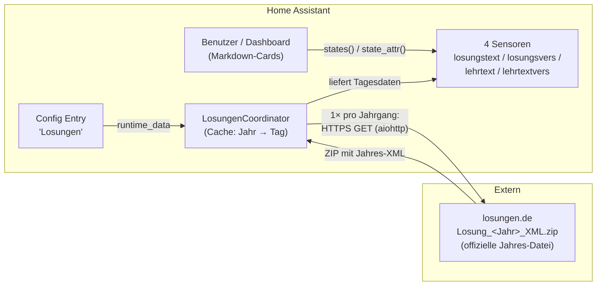

**Schnittstellen:**

| Richtung | Inhalt | Protokoll |
|---|---|---|
| losungen.de → Integration | ZIP mit `Losungen Free <Jahr>.xml` | HTTPS GET, `User-Agent` gesetzt, Timeout 60 s |
| Integration → HA | 4 Sensor-States + Attribute | HA Entity Platform (`sensor.py`) |
| HA → Integration | Config Entry anlegen/entladen | Config Flow + `async_setup_entry` |

---

## 2. Modul-/Paketübersicht

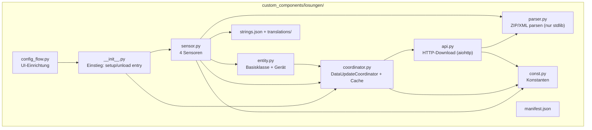

Abhängigkeitsrichtung: `sensor.py` und `coordinator.py` sind die zentralen
Module; `parser.py` ist bewusst HA-frei (nur Standardbibliothek) und damit
allein testbar.

---

## 3. UML-Klassendiagramm

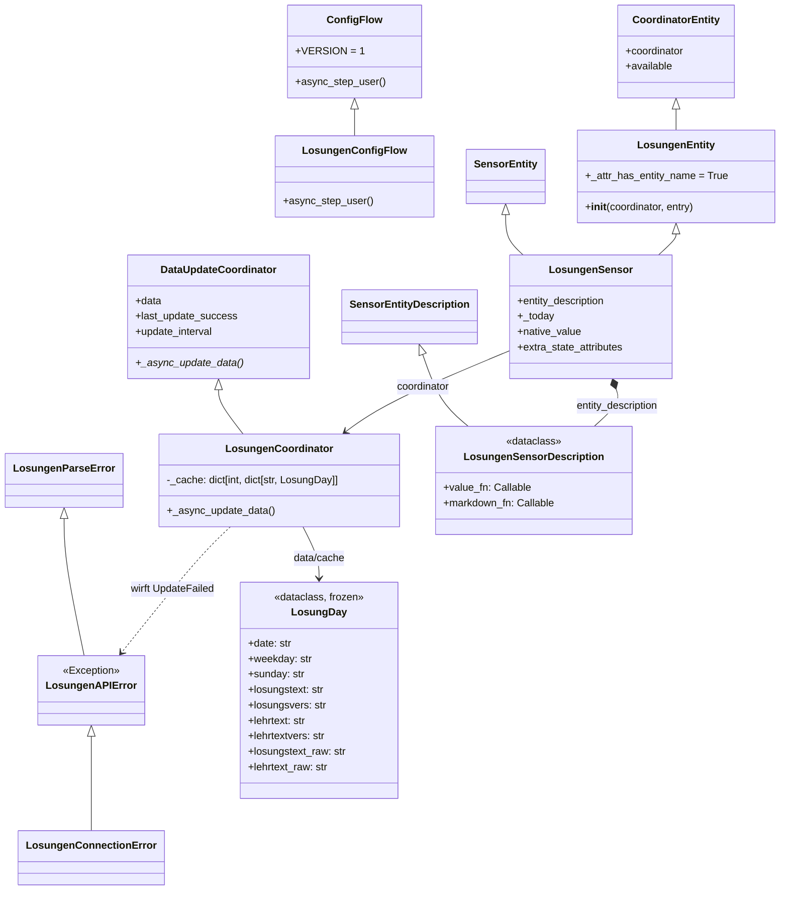

**Vererbung (Pfeil mit leerer Spitze `◁--`):** eigene Klassen erweitern die
HA-Basisklassen. **Komposition (`*--`)**: der Sensor besitzt genau eine
Beschreibung. **Assoziation (`-->`)**: Sensor und Coordinator kennen einander.

---

## 4. ER-Diagramm (Datenmodell)

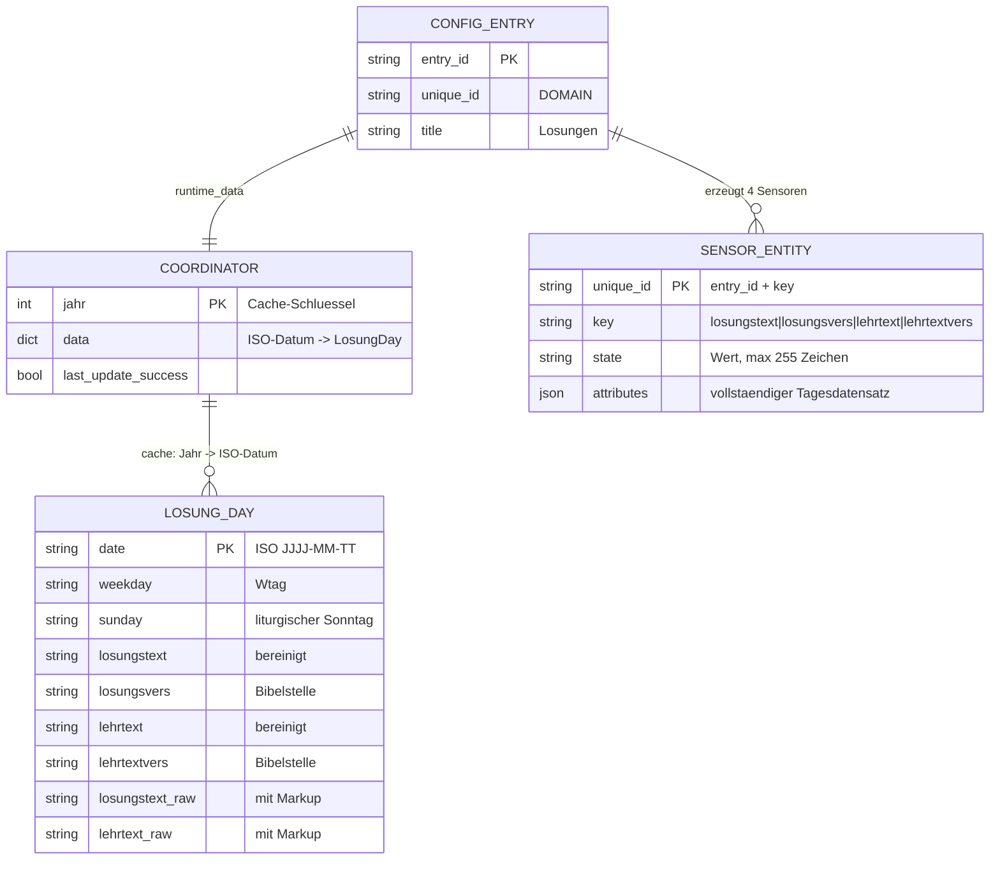

**Kardinalitäten:** Ein Config Entry besitzt genau einen Coordinator
(`||--||`) und vier Sensoren (`||--o{`). Der Coordinator hält pro Jahr ein
dict von `LOSUNG_DAY`-Einträgen (`||--o{`).

---

## 5. UML-Sequenzdiagramme

### 5.1 Einrichtung über die UI (Config Flow + Setup)

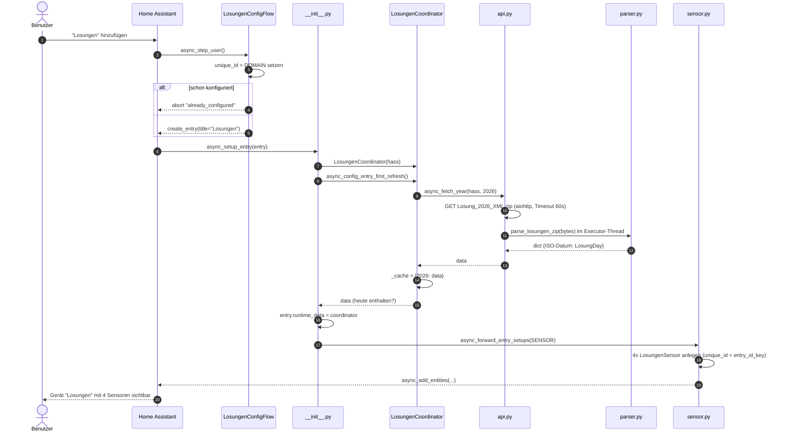

### 5.2 Poll-Update innerhalb desselben Tages (Cache-Treffer)

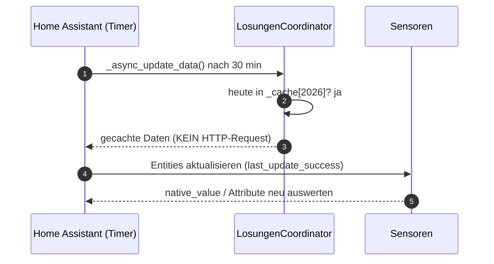

### 5.3 Tageswechsel (Mitternacht) / erstes Laden nach Start

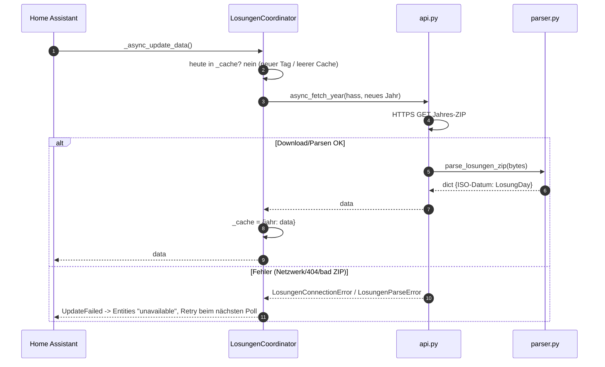

---

## 6. Programmablaufpläne (PAP)

PAP-Symbole in Mermaid: `([Start/Ende])` = Terminal, `[...]` = Verarbeitung,
`{...}` = Verzweigung, `[/.../]` = Ein-/Ausgabe.

### 6.1 `async_setup_entry` (Start der Integration)

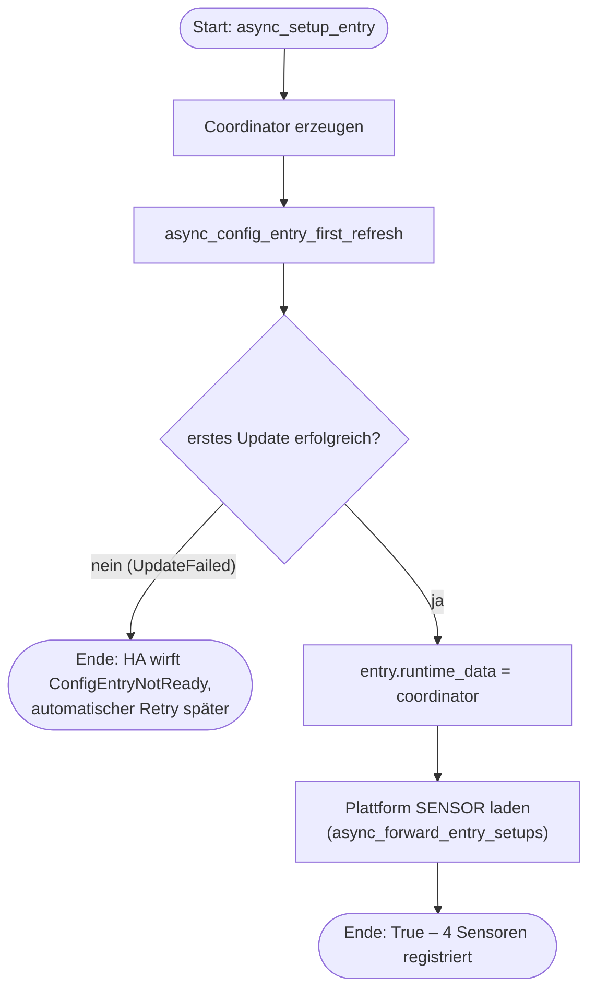

### 6.2 `LosungenCoordinator._async_update_data` ( Kern des Polls)

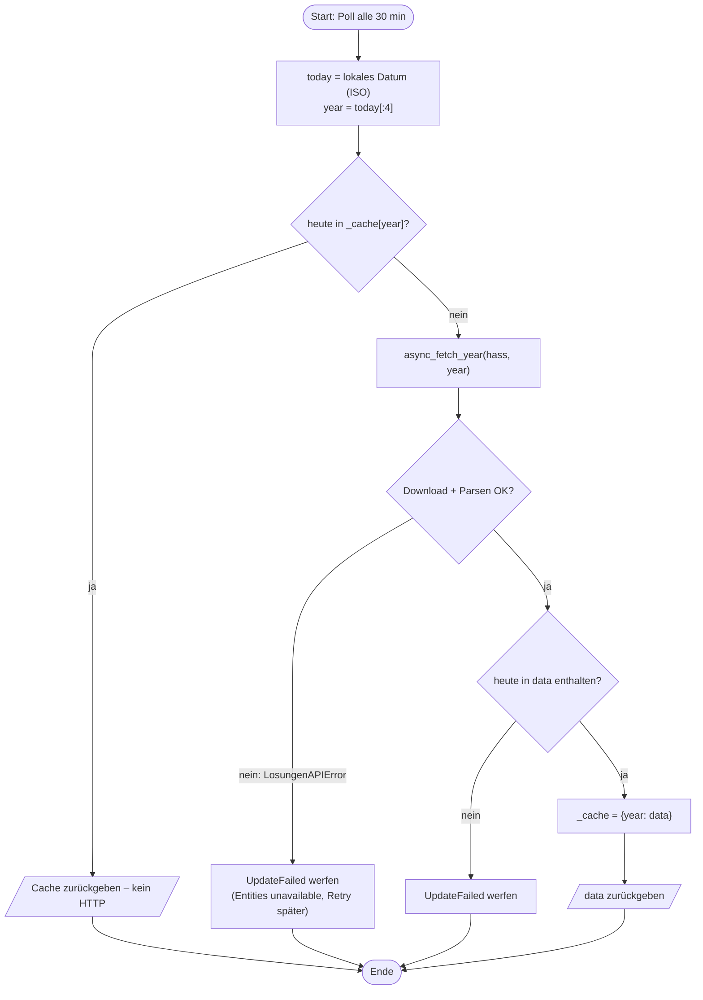

### 6.3 `async_fetch_year` (Netzwerk + Parsen)

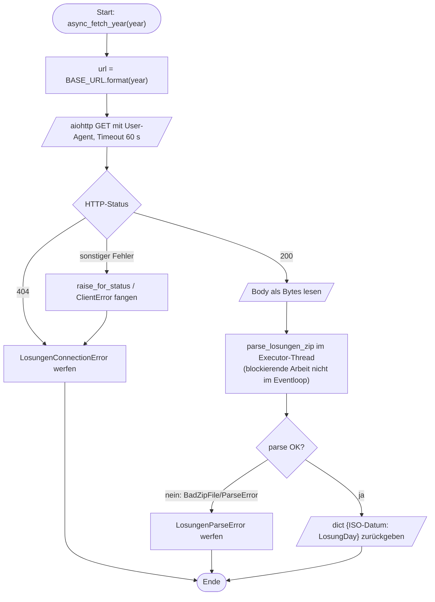

### 6.4 `parse_losungen_zip` / `parse_losungen_xml`

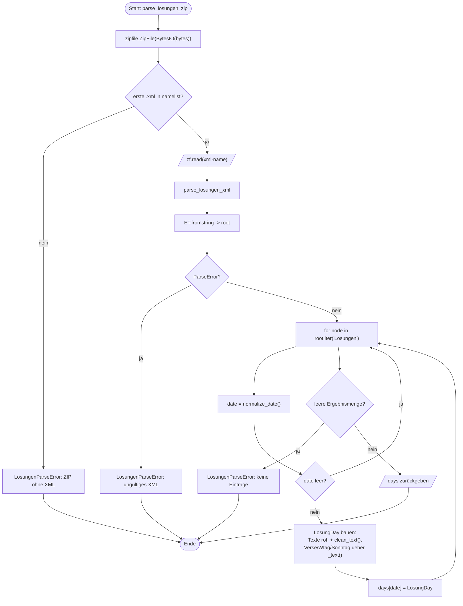

### 6.5 `LosungenSensor.native_value` / `extra_state_attributes`

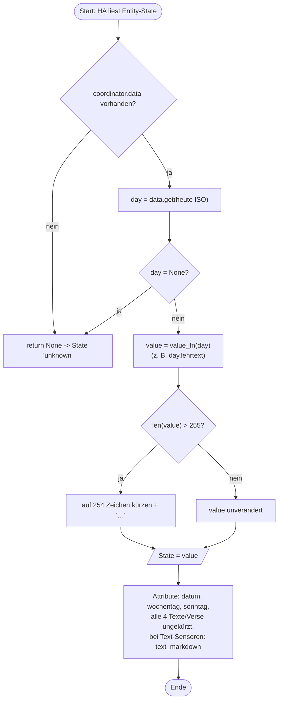

---

## 7. Struktogramme (Nassi-Shneiderman)

ASCII-Struktogramme der drei zentralen Funktionen. Rechteck = Anweisung,
umrandeter Bereich = Schleife, Dreieck/Ecke = Verzweigung.

### 7.1 `_async_update_data`

```
+----------------------------------------------------------+
| _async_update_data()                                     |
+----------------------------------------------------------+
| today = dt_util.now().date().isoformat()                 |
| year  = int(today[:4])                                   |
| cached = self._cache.get(year, {})                       |
+----------------------------------------------------------+
| IF today in cached:                                      |
|   +----------------------------------------------------+ |
|   | return cached            # Cache-Treffer, kein HTTP| |
|   +----------------------------------------------------+ |
+----------------------------------------------------------+
| try:                                                     |
|   data = await async_fetch_year(hass, year)              |
| except LosungenAPIError as err:                          |
|   +----------------------------------------------------+ |
|   | raise UpdateFailed(...)  # Entities unavailable     | |
|   +----------------------------------------------------+ |
+----------------------------------------------------------+
| IF today not in data:                                    |
|   +----------------------------------------------------+ |
|   | raise UpdateFailed('Kein Eintrag für today')        | |
|   +----------------------------------------------------+ |
+----------------------------------------------------------+
| self._cache = {year: data}                               |
| return data                                              |
+----------------------------------------------------------+
```

### 7.2 `parse_losungen_xml`

```
+----------------------------------------------------------+
| parse_losungen_xml(xml_data)                             |
+----------------------------------------------------------+
| try: root = ET.fromstring(xml_data)                      |
| except ParseError: raise LosungenParseError              |
+----------------------------------------------------------+
| days = {}                                                |
+----------------------------------------------------------+
| FOR node IN root.iter("Losungen"):                       |
|   +----------------------------------------------------+ |
|   | date = normalize_date(_text(node.find("Datum")))   | |
|   | IF date == "": continue                            | |
|   | losungstext_raw = _text(node.find("Losungstext"))  | |
|   | lehrtext_raw    = _text(node.find("Lehrtext"))     | |
|   | days[date] = LosungDay(date, weekday, sunday,      | |
|   |   clean_text(losungstext_raw), Losungsvers,        | |
|   |   clean_text(lehrtext_raw), Lehrtextvers, raw...)  | |
|   +----------------------------------------------------+ |
+----------------------------------------------------------+
| IF days == {}: raise LosungenParseError                  |
| return days                                              |
+----------------------------------------------------------+
```

### 7.3 `async_fetch_year`

```
+----------------------------------------------------------+
| async_fetch_year(hass, year)                             |
+----------------------------------------------------------+
| session = async_get_clientsession(hass)                  |
| url = BASE_URL.format(year=year)                         |
| try:                                                     |
|   +----------------------------------------------------+ |
|   | WITH asyncio.timeout(60):                          | |
|   |   response = await session.get(url, headers=...)  | |
|   |   IF status == 404: raise LosungenConnectionError  | |
|   |   response.raise_for_status()                      | |
|   |   payload = await response.read()                  | |
|   +----------------------------------------------------+ |
| except (ClientError, TimeoutError):                      |
|   +----------------------------------------------------+ |
|   | raise LosungenConnectionError from err             | |
|   +----------------------------------------------------+ |
+----------------------------------------------------------+
| return await hass.async_add_executor_job(                |
|            parse_losungen_zip, payload)  # Thread, nicht  |
|            # im Eventloop                                 |
+----------------------------------------------------------+
```

---

## 8. EPK (ereignisgesteuerte Prozesskette)

EPK-Notation: **Ereignisse** = Sechsecke `{{...}}`, **Funktionen** = abgerundete
Rechtecke `(...)`, **Konnektoren** (XOR = Entweder-Oder) = Rauten. Hier der
Poll-Zyklus der Integration als EPK:

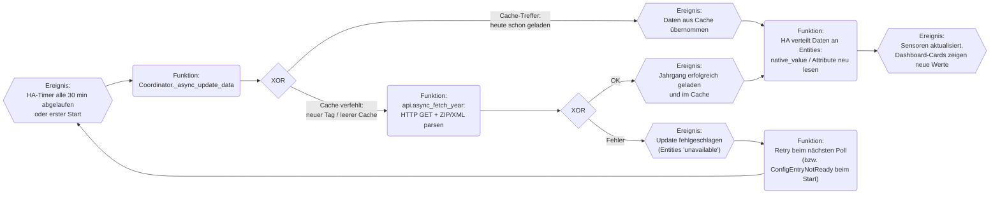

**Lesart:** Ein Ereignis stößt eine Funktion an; die Funktion endet in einem
neuen Ereignis. Der XOR-Konnektor `X2` trennt den Erfolgs- vom Fehlerpfad.

---

## 9. UML-Zustandsdiagramm

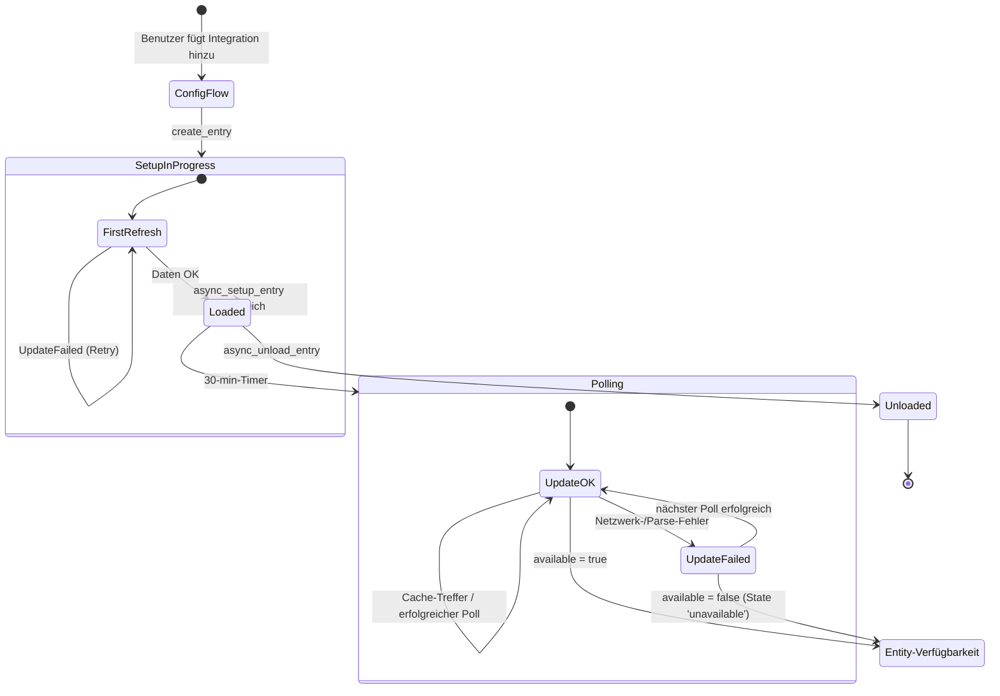

---

## 10. Datenmodell der Quelle (XML)

Die Jahres-ZIP enthält eine XML-Datei mit folgendem Aufbau:

```xml
<Losungsjahr>                      <!-- Wurzelelement (Name egal, wird ignoriert) -->
  <Losungen>                       <!-- ein Element PRO TAG -->
    <Datum>2026-11-23</Datum>      <!-- ISO oder TT.MM.JJJJ -->
    <Wtag>Montag</Wtag>
    <Sonntag>Letzter Sonntag des Kirchenjahres</Sonntag>
    <Losungstext>/Einleitung:/ Text mit #Hervorhebung#</Losungstext>
    <Losungsvers>Jesaja 55,10-11</Losungsvers>
    <Lehrtext>Text des Lehrtexts ...</Lehrtext>
    <Lehrtextvers>Lukas 8,15</Lehrtextvers>
  </Losungen>
  ...
</Losungsjahr>
```

| XML-Feld | Bedeutung | Ziel-Feld in `LosungDay` |
|---|---|---|
| `Datum` | Datum des Eintrags | `date` (normalisiert auf ISO) |
| `Wtag` | Wochentag | `weekday` |
| `Sonntag` | liturgischer Sonntag (oft leer) | `sunday` |
| `Losungstext` | Text der Tageslosung (mit `/…/`, `#…#`) | `losungstext` (clean_text) + `losungstext_raw` |
| `Losungsvers` | Bibelstelle der Losung | `losungsvers` |
| `Lehrtext` | Text des Lehrtexts | `lehrtext` + `lehrtext_raw` |
| `Lehrtextvers` | Bibelstelle des Lehrtexts | `lehrtextvers` |

---

## 11. Fehlerbehandlung

| Fehler | Wo | Reaktion |
|---|---|---|
| `LosungenConnectionError` (Netzwerk, Timeout, 404) | `api.py` | `coordinator.py` wirft `UpdateFailed` → Entities `unavailable`, Retry beim nächsten Poll (beim Start: `ConfigEntryNotReady` mit automatischem Retry) |
| `LosungenParseError` (kein ZIP / kein XML / ungültiges XML / keine Einträge) | `parser.py` | wie oben |
| Heutiger Tag fehlt in der Jahresdatei | `coordinator.py` | `UpdateFailed` |
| Text länger als 255 Zeichen | `sensor.py:_truncate` | State gekürzt mit `…`, voller Text im Attribut |
| Doppelter Config Entry | `config_flow.py` | `abort: already_configured` |
